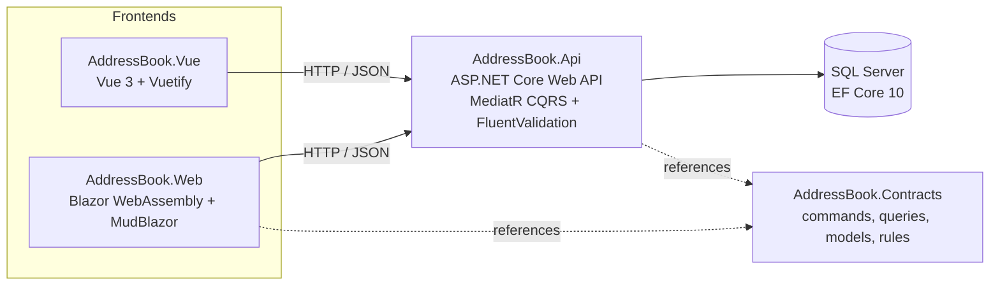

# AddressBook2025

A full-stack address book: an ASP.NET Core Web API with two interchangeable single-page frontends — Blazor WebAssembly and Vue 3 — covered by component tests and Playwright end-to-end suites, built with an AI-assisted development workflow.

[](https://github.com/askrinnik/AddressBook2025/actions/workflows/build.yml)
[](https://github.com/askrinnik/AddressBook2025/actions/workflows/api-tests.yml)
[](https://github.com/askrinnik/AddressBook2025/actions/workflows/ui-tests.yml)
[](https://github.com/askrinnik/AddressBook2025/actions/workflows/web-tests.yml)
[](https://github.com/askrinnik/AddressBook2025/actions/workflows/vue-tests.yml)
[](https://github.com/askrinnik/AddressBook2025/actions/workflows/security.yml)

[](https://dotnet.microsoft.com/)
[](https://learn.microsoft.com/dotnet/csharp/)
[](https://dotnet.microsoft.com/apps/aspnet/web-apps/blazor)
[](https://mudblazor.com/)
[](https://vuejs.org/)
[](https://vuetifyjs.com/)
[](https://www.typescriptlang.org/)
[](https://learn.microsoft.com/ef/core/)
[](https://playwright.dev/)

[](LICENSE)
[](https://github.com/askrinnik/AddressBook2025/commits/main)
[](https://github.com/askrinnik/AddressBook2025/issues)
[](https://github.com/askrinnik/AddressBook2025/pulls)

## Contents

- [Features](#features)
- [Architecture](#architecture)
- [Tech stack](#tech-stack)
- [Repository structure](#repository-structure)
- [Getting started](#getting-started)
- [Build](#build)
- [Testing](#testing)
- [CI/CD](#cicd)
- [Documentation](#documentation)
- [AI-assisted development](#ai-assisted-development)
- [Contributing](#contributing)
- [Security](#security)
- [License](#license)

## Features

- **Contacts** — list, create, edit and delete contacts (first name, last name, optional birthday); deletion asks for confirmation.
- **Search, sort and paging** — the list searches first and last names on the server and sorts and pages in the browser.
- **Validation on both sides** — names are required and at most 30 characters; a birthday cannot be in the future. The API (FluentValidation) and both frontends read the same rules from the shared `AddressBook.Contracts` library.
- **Consistent errors** — the API returns every error as RFC 7807 problem details; both frontends show validation errors next to the fields and other errors in a global banner.
- **Two frontends, one API** — the Blazor WebAssembly app (MudBlazor) and the Vue 3 app (Vuetify) offer the same pages and behaviour, and one UI end-to-end suite runs against both.
- **Interactive API docs** — the API serves its OpenAPI document with Swagger UI and Scalar.

## Architecture



- **API** — thin controllers send MediatR requests to handlers; FluentValidation validators run before the handlers; repositories built on EF Core work with strongly typed IDs; a global exception handler turns failures into problem details. Migrations run when the API starts.
- **Contracts** — the request, response and model types plus the validation limits, shared by the API and the Blazor app; the Vue app mirrors them in TypeScript.
- **Frontends** — static single-page apps that call the API at a configured base URL (`http://localhost:5000/api/` by default).

Details: [docs/specs/Architecture.md](docs/specs/Architecture.md).

## Tech stack

| Project | Type | Key technologies |
|---|---|---|
| [`AddressBook.Api`](src/AddressBook.Api) | REST API | .NET 10, ASP.NET Core, MediatR 12, FluentValidation 12, EF Core 10 (SQL Server), Swashbuckle 10 + Scalar 2 |
| [`AddressBook.Contracts`](src/AddressBook.Contracts) | Class library | .NET 10, MediatR.Contracts — DTOs and shared validation rules |
| [`AddressBook.Web`](src/AddressBook.Web) | SPA | Blazor WebAssembly (.NET 10), MudBlazor 9.8 |
| [`AddressBook.Vue`](src/AddressBook.Vue) | SPA | Vue 3.5 (`<script setup>`, TypeScript 6), Vite 8, Vue Router 5, Vuetify 4 |
| [`AddressBook.Web.Tests`](src/AddressBook.Web.Tests) | Component tests | bUnit 2.9, xUnit v3, NSubstitute, Bogus, Microsoft.Testing.Platform |
| [`AddressBook.Vue/tests`](src/AddressBook.Vue/tests) | Component tests | Vitest 5, @vue/test-utils, jsdom |
| [`ApiTests`](src/ApiTests) | API end-to-end tests | Playwright Test (`APIRequestContext`), TypeScript |
| [`UiTests`](src/UiTests) | UI end-to-end tests | Playwright Test (Chromium), TypeScript, page and component objects |

Shared build settings live under `src/`: Central Package Management in [`Directory.Packages.props`](src/Directory.Packages.props), lock files restored in locked mode, code style enforced on build ([`Directory.Build.props`](src/Directory.Build.props), [`.editorconfig`](src/.editorconfig)).

## Repository structure

```text
AddressBook2025/
├── src/
│   ├── AddressBook.slnx           # .NET solution (API, Contracts, Web, Web.Tests)
│   ├── AddressBook.Api/           # ASP.NET Core Web API
│   ├── AddressBook.Contracts/     # Shared contracts and validation rules
│   ├── AddressBook.Web/           # Blazor WebAssembly frontend
│   ├── AddressBook.Web.Tests/     # bUnit component tests
│   ├── AddressBook.Vue/           # Vue 3 frontend (standalone npm project, Vitest tests)
│   ├── ApiTests/                  # Playwright API end-to-end tests
│   └── UiTests/                   # Playwright UI end-to-end tests (Blazor and Vue)
├── docs/
│   ├── specs/                     # Technical specifications per project
│   ├── guides/                    # Learning guides
│   ├── tasks/                     # Implementation plans per issue
│   └── ai/                        # How the AI workflow is built
├── .github/
│   ├── workflows/                 # GitHub Actions CI
│   └── instructions/              # Coding standards per file type
├── .ai/ .claude/                  # AI assistant commands, agents and skills
└── global.json                    # Enables Microsoft.Testing.Platform for dotnet test
```

## Getting started

### Prerequisites

| Tool | Version | Needed for |
|---|---|---|
| [.NET SDK](https://dotnet.microsoft.com/download) | 10.0 | API, Blazor app, bUnit tests |
| [Node.js](https://nodejs.org/) | 20.19+ or 22.12+ (LTS) | Vue app, Playwright suites |
| SQL Server | 2022 (Express, Developer or the Docker image) | API |

### 1. Start a database

The API connects to `localhost\SQLEXPRESS` by default and creates the `AddressBook` database itself on first start. Without a local SQL Server, run one in Docker:

```bash
docker run -d --name addressbook-sql -e "ACCEPT_EULA=Y" -e "MSSQL_SA_PASSWORD=<your-strong-password>" -p 1433:1433 mcr.microsoft.com/mssql/server:2022-latest
```

### 2. Run the API

```bash
dotnet run --project src/AddressBook.Api
```

To use the Docker database, pass the server and credentials as configuration overrides:

```bash
dotnet run --project src/AddressBook.Api -- --Database:Server=localhost,1433 --Database:User=sa --Database:Password=<your-strong-password>
```

The API listens on `http://localhost:5000`; Swagger UI is at `/swagger` and Scalar at `/scalar`. Configuration options: [docs/specs/AddressBook.Api.md](docs/specs/AddressBook.Api.md).

### 3. Run a frontend

Blazor WebAssembly:

```bash
dotnet run --project src/AddressBook.Web --launch-profile https
```

The app opens on `https://localhost:7187` (the `http` profile uses `http://localhost:5156`).

Vue:

```bash
cd src/AddressBook.Vue
npm ci
npm run dev
```

The app opens on `http://localhost:5173`. More options: [src/AddressBook.Vue/README.md](src/AddressBook.Vue/README.md).

Both frontends call the API at `http://localhost:5000/api/`, so start the API first.

## Build

The commands CI runs:

```bash
dotnet restore src/AddressBook.slnx --locked-mode
dotnet build src/AddressBook.slnx --configuration Release --no-restore
```

The Vue app is built separately; `npm run build` type-checks with `vue-tsc` before Vite bundles the app:

```bash
cd src/AddressBook.Vue
npm ci
npm run lint
npm run build
```

## Testing

| Suite | Layer | Framework | What it covers | Needs | Run | CI |
|---|---|---|---|---|---|---|
| [`src/AddressBook.Web.Tests`](src/AddressBook.Web.Tests/README.md) | Component | bUnit + xUnit v3 | Blazor pages, layout, forms and validation, the API service and the problem-details error pipeline; the API is substituted | .NET SDK only | `dotnet test --project src/AddressBook.Web.Tests` | [web-tests.yml](.github/workflows/web-tests.yml) |
| [`src/AddressBook.Vue/tests`](src/AddressBook.Vue/README.md#tests) | Component | Vitest + @vue/test-utils (jsdom) | Vue pages, components, composables, router, validation rules and the API client; the API is mocked | Node only | `npm test` in `src/AddressBook.Vue` | [vue-tests.yml](.github/workflows/vue-tests.yml) |
| [`src/ApiTests`](src/ApiTests/README.md) | API end-to-end | Playwright `APIRequestContext` | All five `Contacts` endpoints: happy paths, boundaries, negatives, the CRUD lifecycle, problem-details and response schemas | SQL Server; the suite starts the API | `npm ci`, then `npm test` in `src/ApiTests` | [api-tests.yml](.github/workflows/api-tests.yml) |
| [`src/UiTests`](src/UiTests/README.md) | UI end-to-end | Playwright (Chromium), projects `blazor` and `vue` | Real user flows in both frontends: app shell and navigation, list, search, sort and paging, create, edit, delete, validation, not-found, accessibility | SQL Server and Playwright browsers; the suite starts the API, the Blazor app and the Vue build | `npm ci`, `npx playwright install`, then `npm test` in `src/UiTests` | [ui-tests.yml](.github/workflows/ui-tests.yml) |

- **Coverage gates** — CI fails when line coverage drops below 85 % or branch coverage below 70 %: for `AddressBook.Web` (ReportGenerator) and for the Vue app (`vitest.config.ts`, also locally with `npm run test:coverage`).
- **Not covered** — the API has no unit or integration tests in .NET; its behaviour is covered end to end by `src/ApiTests` and, through the frontends, by `src/UiTests`. `AddressBook.Contracts` is covered through the suites that use it.
- **Reports** — every CI run publishes the Playwright HTML reports, the test results and the coverage reports as artifacts; the bUnit and Vitest results also appear as check runs.

Conventions for writing tests: [Playwright](.github/instructions/playwright-conventions.instructions.md), [bUnit](.github/instructions/bunit-conventions.instructions.md), [Vue and Vitest](.github/instructions/vue.instructions.md).

## CI/CD

| Workflow | Runs on | What it does |
|---|---|---|
| [Build source code](.github/workflows/build.yml) | every push | Restores in locked mode and builds the .NET solution in Release |
| [API E2E Tests](.github/workflows/api-tests.yml) | every push, manual | Runs `src/ApiTests` against the API and a SQL Server 2022 service container |
| [UI E2E Tests](.github/workflows/ui-tests.yml) | every push, manual | Runs `src/UiTests` (projects `blazor` and `vue`) against the API, both frontends and SQL Server |
| [Web Component Tests](.github/workflows/web-tests.yml) | pull requests and `main` when Web code changes, manual | Runs the bUnit suite, publishes the results and enforces the coverage gate |
| [Vue Frontend](.github/workflows/vue-tests.yml) | pull requests and `main` when Vue code changes, manual | Lint, format check, type check and build, then Vitest with the coverage gate |
| [Security Vulnerability Scan](.github/workflows/security.yml) | pushes and pull requests to `main`, weekly | Fails on vulnerable NuGet packages and on high or critical npm advisories |

The end-to-end workflows need the repository secret `MSSQL_SA_PASSWORD`: the SA password of the throwaway SQL Server container. Workflow details: [docs/specs/Architecture.md](docs/specs/Architecture.md#7-cicd).

## Documentation

| Topic | Document |
|---|---|
| Architecture, project structure, CI | [docs/specs/Architecture.md](docs/specs/Architecture.md) |
| API: endpoints, CQRS, validation, data access | [docs/specs/AddressBook.Api.md](docs/specs/AddressBook.Api.md) |
| Contracts: commands, queries, models | [docs/specs/AddressBook.Contracts.md](docs/specs/AddressBook.Contracts.md) |
| Blazor frontend | [docs/specs/AddressBook.Web.md](docs/specs/AddressBook.Web.md) |
| Vue frontend | [docs/specs/AddressBook.Vue.md](docs/specs/AddressBook.Vue.md) |
| Vue for Blazor developers (in Russian) | [docs/guides/vue-for-blazor-developers.md](docs/guides/vue-for-blazor-developers.md) |
| Implementation plans | [docs/tasks/](docs/tasks) |
| AI workflow | [docs/ai/README.md](docs/ai/README.md) |

## AI-assisted development

The project is developed with **Claude Code** and **GitHub Copilot**, which share one set of instructions: [CLAUDE.md](CLAUDE.md), the coding standards in [.github/instructions/](.github/instructions), and skills and commands kept in sync between `.github/` and `.claude/`.

- `/implement-issue <n>` takes a GitHub issue end to end: plan, implementation with tests, build, verification in a real browser, commit and pull request, with review checkpoints for the developer.
- `/implement-issues <n> <n> …` runs several small issues in a row and ships them in one pull request.
- `/next-issue` recommends the next issue whose blockers are closed.

How the workflow, agents and skills are built: [docs/ai/README.md](docs/ai/README.md).

## Contributing

1. Open an issue with the [Bug](.github/ISSUE_TEMPLATE/bug.yml) or [Task](.github/ISSUE_TEMPLATE/task.yml) template.
2. Work on a branch named `<issue>-<short-slug>`, for example `145-scaffold-web-tests`.
3. Write commit messages as `#<issue> <issue title>`, followed by a list of actions.
4. Follow the coding standards in [.github/instructions/](.github/instructions); comments in code are in English.
5. Ship new or changed API behaviour with Playwright tests in `src/ApiTests`, and keep the documents in `docs/specs/` in step with the code.
6. Open a pull request into `main` that contains `Closes #<issue>`; CI must be green before it is merged with a merge commit.

## Security

- The [Security Vulnerability Scan](.github/workflows/security.yml) checks the NuGet and npm dependencies on every change to `main` and every week.
- NuGet versions are pinned centrally and restored from lock files; GitHub Actions in the newer workflows are pinned to commit SHAs.
- To report a vulnerability, do not open a public issue: contact the maintainer, [@askrinnik](https://github.com/askrinnik), privately on GitHub.

## License

This project is licensed under the [MIT License](LICENSE).
